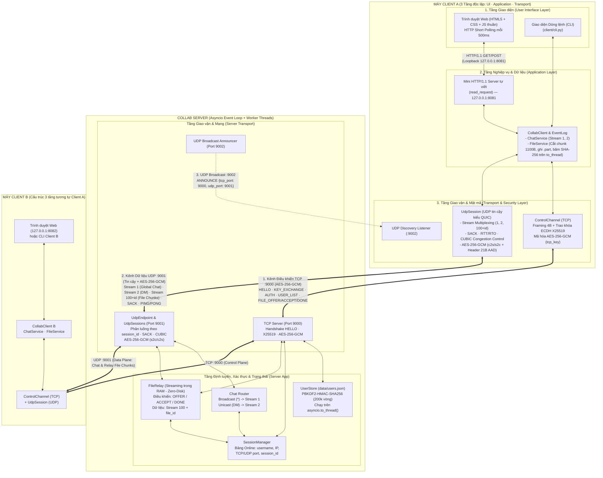

# CHƯƠNG 2: KIẾN TRÚC HỆ THỐNG (SYSTEM ARCHITECTURE)
*(Trích xuất từ mục 10.2 và mục 7 của đề bài để đưa trực tiếp vào Báo cáo Kỹ thuật PDF)*

---

## 1. Sơ đồ Kiến trúc Tổng thể (High-Level System Architecture Diagram)

---

## 2. Thuyết minh Chi tiết: Sự Phân tầng và Tương tác giữa Client và Server

Đáp ứng đúng yêu cầu của đề bài: **"Must clearly separate network logic, data processing, and the user interface"**, hệ thống được tổ chức thành 3 tầng chức năng độc lập:

### 2.1. Phân tầng bên trong Client (Client-Side Modular Layering)
1. **Tầng Giao diện (User Interface Layer):**
   - Bao gồm Giao diện Web (HTML5/CSS/Vanilla JavaScript) và Giao diện dòng lệnh (`client/cli.py`).
   - *Nguyên lý thiết kế:* Trình duyệt web chạy trong môi trường bảo mật (Sandbox) không thể mở socket TCP/UDP thô. Do đó, giao diện Web chỉ tương tác với tầng dưới qua giao thức HTTP/1.1 trên địa chỉ nội bộ máy (`http://127.0.0.1:8081`). Giao diện sử dụng cơ chế **HTTP Short Polling (mỗi 500ms)** qua endpoint `GET /api/events?since=<last_id>` để cập nhật tin nhắn chat và thanh tiến độ truyền file theo thời gian thực mà không vi phạm quy định cấm WebSocket của đề bài.
2. **Tầng Nghiệp vụ & Dữ liệu (Application & Data Processing Layer):**
   - Đảm nhiệm toàn bộ logic xử lý dữ liệu của người dùng:
     - `HttpServer`: Tự phân tích cú pháp HTTP/1.1 bằng socket TCP thô (`read_request`), phục vụ các REST API và file tĩnh.
     - `ChatService`: Đóng gói dữ liệu chat thành JSON UTF-8.
     - `FileService`: Đảm bảo an toàn bộ nhớ khi truyền file lớn: chia file nguồn thành các khối nhỏ `CHUNK_SIZE = 1100 byte`, ghi dữ liệu nhận được vào file tạm `.part`, đẩy phép tính băm `SHA-256` sang worker thread (`asyncio.to_thread`) để không làm đơ giao diện, và thực hiện đổi tên nguyên tử `os.replace` khi kiểm tra toàn vẹn thành công.
3. **Tầng Giao vận & Mật mã (Transport & Security Layer):**
   - Là tầng chịu trách nhiệm kết nối mạng thực sự ra bên ngoài LAN:
     - `ControlChannel (TCP)`: Quản lý kết nối TCP, đóng khung tiền tố độ dài 4 byte, mã hóa toàn bộ dữ liệu điều khiển bằng AES-256-GCM sau khi trao khóa.
     - `UdpSession (UDP tin cậy)`: Đóng gói Header 21 byte, quản lý sliding window, tính toán RTT/RTO, phản hồi SACK, kiểm soát tắc nghẽn CUBIC và đa hợp các luồng độc lập.

---

### 2.2. Ba Kênh Tương tác Mạng giữa Client và Server (LAN Interaction Channels)

Client và Server giao tiếp với nhau qua 3 kênh mạng riêng biệt trên 3 cổng khác nhau:

1. **Kênh Điều khiển (Control Plane — TCP Port 9000):**
   - Sử dụng kết nối TCP bền vững (Persistent Connection), được bảo vệ bằng mã hóa AES-256-GCM.
   - *Nhiệm vụ:* Thực hiện Handshake bắt tay (`HELLO` / `HELLO_ACK`), trao khóa bất đối xứng `ECDH X25519`, xác thực tài khoản (`AUTH_REQ` / `AUTH_OK`), nhận thông báo presence (`USER_JOIN` / `USER_LEAVE`), và thực hiện bắt tay 3 bước thỏa thuận truyền file (`FILE_OFFER` $\rightarrow$ `FILE_ACCEPT` $\rightarrow$ `FILE_DONE`).
2. **Kênh Dữ liệu (Data Plane — UDP Port 9001):**
   - Sử dụng giao thức tầng ứng dụng tự thiết kế chạy trên UDP tin cậy (QUIC-like), mã hóa AES-256-GCM với khóa riêng cho mỗi chiều (`c2s` và `s2c`).
   - *Nhiệm vụ:*
     - **Truyền tin nhắn Chat (Stream 1 và Stream 2):** Tin nhắn phòng chung được gửi lên `Stream 1`, Server đọc và chuyển tiếp tới toàn bộ Client online. Tin nhắn riêng gửi lên `Stream 2`, Server chuyển tiếp chính xác tới Client đích.
     - **Truyền File dung lượng lớn (Stream 100 + file_id):** Khi file được chấp nhận, Client gửi bắn liên tục các mảnh 1100 byte lên Stream tương ứng. Server đóng vai trò **Streaming Relay (Cut-through)**: đọc từng mảnh từ buffer RAM và chuyển tiếp ngay lập tức sang Client nhận, hoàn toàn **không lưu file vào ổ đĩa của Server (Zero-Disk Footprint)**.
     - **Chống Head-of-Line Blocking:** Nhờ kiến trúc Stream Multiplexing, việc rớt gói tin ở Stream File (101) không bao giờ làm nghẽn hoặc làm trễ tin nhắn chat ở Stream Chat (1).
3. **Kênh Khám phá Dịch vụ (Discovery Plane — UDP Broadcast Port 9002):**
   - Server định kỳ phát gói tin UDP Broadcast `ANNOUNCE` chứa thông tin cổng TCP và UDP của Server vào mạng LAN (`255.255.255.255:9002`).
   - Khi Client khởi động mà không truyền tham số `--server`, Client sẽ tự động lắng nghe cổng 9002 trong 5 giây để lấy địa chỉ IP của Server và tự động kết nối, mang lại trải nghiệm không cần cấu hình thủ công (Zero-Configuration Networking).

