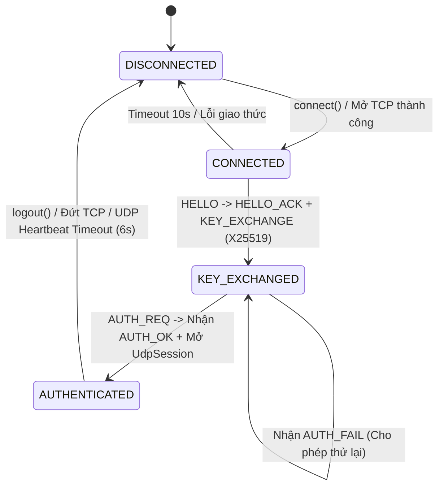
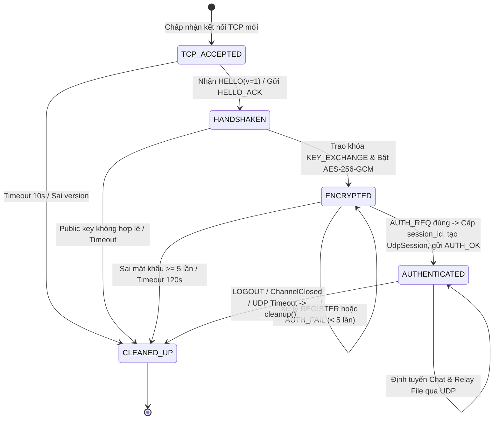
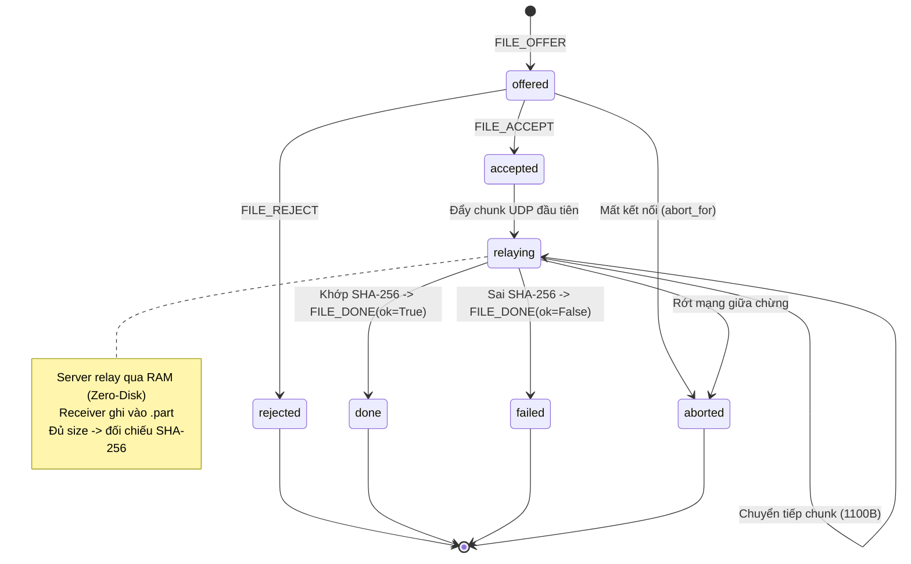

# PROTOCOL SPECIFICATION — ĐẶC TẢ GIAO THỨC TẦNG ỨNG DỤNG (v1.0)

> Tài liệu này đặc tả toàn bộ cấu trúc khung bản tin (Frame/Packet Layout), kiểu dữ liệu nhị phân, tập lệnh điều khiển và máy trạng thái của ứng dụng **Collab LAN**. Bạn có thể trích xuất trực tiếp nội dung và các bảng/sơ đồ dưới đây vào mục **Protocol Specification** trong Báo cáo Kỹ thuật (PDF).

---

## 1. Tổng quan Kiến trúc Giao thức Đa kênh (Multi-Plane Overview)

Giao thức tầng ứng dụng được thiết kế theo mô hình **Hybrid Dual-Plane** (tách biệt Kênh Điều khiển và Kênh Dữ liệu), kết hợp ưu điểm của TCP và kiến trúc truyền luồng tin cậy trên UDP kiểu **Google QUIC**:

| Kênh (Plane) | Giao thức nền | Cổng | Định dạng bản tin | Bảo mật | Nhiệm vụ chính |
|---|---|---|---|---|---|
| **Control Plane** | TCP | `9000` | Length-prefixed (`4B`) + UTF-8 JSON | `ECDH X25519` + `AES-256-GCM` (random nonce `12B`) | Handshake, trao khóa, đăng ký/đăng nhập, đồng bộ danh sách online, điều phối gửi/nhận file. |
| **Data Plane** | UDP (Custom Reliable) | `9001` | Binary Header (`21B`) + Stream Payload | `AES-256-GCM` (`nonce = IV XOR pn`, Header `21B` làm `AAD`) | Truyền luồng Chat thời gian thực (`Stream 1, 2`) và các mảnh dữ liệu File (`Stream 100+id`). |
| **Discovery Plane** | UDP Broadcast | `9002` | UTF-8 JSON Datagram | Không mã hóa (thông tin công khai) | Quảng bá bản tin `ANNOUNCE` mỗi 2 giây để Client tự tìm IP/Port của Server trong LAN. |
| **Local UI Plane** | HTTP/1.1 (Raw Socket) | `8081+` | Chuẩn HTTP/1.1 (`\r\n\r\n` + Body) | Loopback nội bộ (`127.0.0.1`) | Cầu nối giữa trình duyệt Web (Vanilla JS) và tiến trình Python `CollabClient`. |

Hai kênh TCP và UDP của cùng một người dùng được liên kết chặt chẽ bằng mã định danh phiên **`session_id` (32-bit unsigned integer)** ngẫu nhiên do Server cấp phát trong bản tin `AUTH_OK`.

---

## 2. Cấu trúc Khung bản tin Kênh Điều khiển TCP (TCP Framing & Control Messages)

### 2.1. Sơ đồ Đóng khung TCP (Length-Prefixed Framing — `common/framing.py`)
Vì TCP là giao thức dòng byte (`byte-stream`) không bảo toàn ranh giới bản tin, mọi bản tin trên kênh TCP đều được đóng khung với tiền tố độ dài **4 byte (uint32, Big-Endian / Network Byte Order)**, giới hạn tối đa `MAX_FRAME_SIZE = 1 MB` (`1,048,576` byte):

#### (a) Trạng thái trước khi trao khóa (`HELLO`, `HELLO_ACK`, `KEY_EXCHANGE`):
```text
 0                   1                   2                   3
 0 1 2 3 4 5 6 7 8 9 0 1 2 3 4 5 6 7 8 9 0 1 2 3 4 5 6 7 8 9 0 1
+---------------------------------------------------------------+
|                   Frame Length (4 bytes, uint32 BE)           |
+---------------------------------------------------------------+
|                                                               |
|                   Plaintext UTF-8 JSON Payload                |
|                        (Length bytes)                         |
|                                                               |
+---------------------------------------------------------------+
```

#### (b) Trạng thái sau khi trao khóa (`enable_encryption` đã kích hoạt):
```text
 0                   1                   2                   3
 0 1 2 3 4 5 6 7 8 9 0 1 2 3 4 5 6 7 8 9 0 1 2 3 4 5 6 7 8 9 0 1
+---------------------------------------------------------------+
|                   Frame Length (4 bytes, uint32 BE)           |
+---------------------------------------------------------------+
|                                                               |
|                   Random Nonce (12 bytes)                     |
|                                                               |
+---------------------------------------------------------------+
|                                                               |
|                AES-256-GCM Ciphertext (JSON)                  |
|                    (Length - 28 bytes)                        |
|                                                               |
+---------------------------------------------------------------+
|                                                               |
|              GCM Authentication Tag (16 bytes)                |
|                                                               |
|                                                               |
+---------------------------------------------------------------+
```

### 2.2. Bảng Đặc tả 15 Bản tin Điều khiển JSON (`common/messages.py`)

Mỗi bản tin JSON bắt buộc là một JSON Object có trường `"type"`:

| STT | Loại bản tin (`type`) | Chiều | Cấu trúc các trường dữ liệu (Fields) | Mục đích & Quy tắc xử lý |
|---|---|---|---|---|
| 1 | `HELLO` | C $\rightarrow$ S | `{"type": "HELLO", "version": 1, "client_name": "collab-client"}` | Bản tin đầu tiên ngay khi mở TCP; quá `10s` không gửi sẽ bị ngắt kết nối. |
| 2 | `HELLO_ACK` | S $\rightarrow$ C | `{"type": "HELLO_ACK", "version": 1, "server_name": "collab-server"}` | Server xác nhận hỗ trợ phiên bản giao thức `version = 1`. |
| 3 | `KEY_EXCHANGE` | C $\leftrightarrow$ S | `{"type": "KEY_EXCHANGE", "public_key": "<64-char hex>"}` | Trao khóa công khai `X25519` (`32 byte`); xong bước này cả 2 bên bật `AES-256-GCM`. |
| 4 | `REGISTER` | C $\leftrightarrow$ S | C$\rightarrow$S: `{"type": "REGISTER", "username": "alice", "password": "..."}`<br/>S$\rightarrow$C: `{"type": "REGISTER", "ok": true}` | Đăng ký tài khoản mới; Server băm mật khẩu bằng `PBKDF2` (`200,000` vòng) trên luồng phụ. |
| 5 | `AUTH_REQ` | C $\rightarrow$ S | `{"type": "AUTH_REQ", "username": "alice", "password": "...", "udp_port": 54321}` | Yêu cầu đăng nhập kèm cổng UDP cục bộ của Client. |
| 6 | `AUTH_OK` | S $\rightarrow$ C | `{"type": "AUTH_OK", "session_id": 305419896, "udp_port": 9001, "users": [...]}` | Đăng nhập thành công; cấp `session_id` 32-bit và danh sách người đang online. |
| 7 | `AUTH_FAIL` | S $\rightarrow$ C | `{"type": "AUTH_FAIL", "reason": "sai tên đăng nhập hoặc mật khẩu"}` | Báo lỗi đăng ký/đăng nhập; sai quá 5 lần liên tiếp sẽ bị đóng kết nối. |
| 8 | `USER_LIST` | S $\rightarrow$ C | `{"type": "USER_LIST", "users": [{"username": "bob", "ip": "...", "port": 5001, "since": 1700000}]}` | Đồng bộ toàn bộ danh sách người dùng đang trực tuyến. |
| 9 | `USER_JOIN` | S $\rightarrow$ C | `{"type": "USER_JOIN", "user": {"username": "bob", "ip": "...", "port": 5001, "since": ...}}` | Broadcast cho các client khác khi có thành viên mới đăng nhập. |
| 10 | `USER_LEAVE` | S $\rightarrow$ C | `{"type": "USER_LEAVE", "username": "bob", "reason": "left"}` | Broadcast khi một thành viên đăng xuất hoặc bị đứt mạng. |
| 11 | `FILE_OFFER` | C $\rightarrow$ S $\rightarrow$ C | C$\rightarrow$S: `{"type": "FILE_OFFER", "client_ref": "r1", "to": "bob", "name": "a.pdf", "size": 9000, "sha256": "..."}`<br/>S$\rightarrow$B: `{"type": "FILE_OFFER", "file_id": 1, "from": "alice", "name": "a.pdf", "size": 9000, "sha256": "..."}` | Người gửi mời truyền file kèm kích thước và mã băm `SHA-256` gốc. |
| 12 | `FILE_OFFER_ACK` | S $\rightarrow$ C | `{"type": "FILE_OFFER_ACK", "client_ref": "r1", "file_id": 1}` *(hoặc kèm `"error"`)* | Cấp mã vận đơn `file_id` cho người gửi (hoặc báo lỗi nếu người nhận offline). |
| 13 | `FILE_ACCEPT` | C $\rightarrow$ S $\rightarrow$ C | `{"type": "FILE_ACCEPT", "file_id": 1}` | Người nhận đồng ý $\rightarrow$ kích hoạt truyền dữ liệu trên UDP `Stream (100 + file_id)`. |
| 14 | `FILE_REJECT` | C $\rightarrow$ S $\rightarrow$ C | `{"type": "FILE_REJECT", "file_id": 1, "reason": "người nhận từ chối"}` | Người nhận từ chối lời mời gửi file; Server xóa phiên truyền. |
| 15 | `FILE_DONE` | C $\rightarrow$ S $\rightarrow$ C | `{"type": "FILE_DONE", "file_id": 1, "ok": true, "reason": ""}` | Báo hoàn tất kiểm tra `SHA-256` (hoặc `ok: false` nếu sai hash / một bên rớt mạng). |
| 16 | `LOGOUT` / `ERROR` | C $\leftrightarrow$ S | `{"type": "LOGOUT"}` / `{"type": "ERROR", "reason": "..."}` | Thoát chủ động hoặc thông báo lỗi giao thức. |

---

## 3. Cấu trúc Gói Nhị phân Kênh Dữ liệu UDP (Custom 21-Byte UDP Packet — `transport/packet.py`)

### 3.1. Sơ đồ Bit/Byte của Gói UDP (Chuẩn RFC 32-bit Grid)
Mỗi datagram UDP bắt đầu bằng **21 byte Header cố định** được đóng gói theo chuẩn **Network Byte Order (Big-Endian)** với chuỗi định dạng `struct.Struct("!HBBBIIHIH")`:

```text
 0                   1                   2                   3
 0 1 2 3 4 5 6 7 8 9 0 1 2 3 4 5 6 7 8 9 0 1 2 3 4 5 6 7 8 9 0 1
+-------------------------------+---------------+---------------+
|         Magic (0xC0DE)        |  Version (1)  |   Type (1-5)  |  Bytes 0..3
+---------------+---------------+---------------+---------------+
|   Flags (1B)  |              Session ID (Bytes 5..7)          |  Bytes 4..7
+---------------+-----------------------------------------------+
|   Session ID  |            Packet Number (Bytes 9..11)        |  Bytes 8..11
+---------------+-------------------------------+---------------+
| Packet Number |          Stream ID (2B)       |  Offset (MSB) |  Bytes 12..15
+---------------+-------------------------------+---------------+
|                Offset (Bytes 16..18)          | Payload Len...|  Bytes 16..19
+---------------+-------------------------------+---------------+
| ...Payload Len|                                               |  Byte 20
+---------------+                                               +
|                                                               |
|               AES-256-GCM Encrypted Payload                   |  Bytes 21..
|            (Plaintext Data <= 1100B + GCM Tag 16B)            |  (Max 1116B)
|                                                               |
+---------------------------------------------------------------+
```

### 3.2. Bảng Phân tích Chi tiết Từng Trường trong Header 21 Byte

| Thứ tự | Tên trường | Vị trí Byte | Độ dài | Kiểu (`struct`) | Giá trị / Ý nghĩa & Lý do thiết kế |
|---|---|---|---|---|---|
| 1 | **Magic** | `0 .. 1` | 2 Bytes (16 bits) | `uint16` (`!H`) | Cố định `0xC0DE`. Giúp lọc bỏ ngay lập tức các gói UDP lạ/rác đi lạc vào cổng `9001`. |
| 2 | **Version** | `2` | 1 Byte (8 bits) | `uint8` (`!B`) | Cố định `0x01`. Hỗ trợ nâng cấp giao thức trong tương lai mà không gây xung đột. |
| 3 | **Type** | `3` | 1 Byte (8 bits) | `uint8` (`!B`) | Loại gói UDP:<br/>- `1` (`DATA`): Chở dữ liệu stream, cần xác nhận ACK.<br/>- `2` (`ACK`): Chở khung xác nhận `AckFrame`, không ACK lại.<br/>- `3` (`PING`): Thăm dò kết nối sống (mỗi 2s).<br/>- `4` (`PONG`): Phản hồi gói `PING`.<br/>- `5` (`CLOSE`): Đóng phiên UDP có kiểm soát. |
| 4 | **Flags** | `4` | 1 Byte (8 bits) | `uint8` (`!B`) | Bitmask cờ điều khiển: `bit 0 = 0x01 (FIN)` đánh dấu **End-of-Message** (mảnh cuối cùng của một bản tin trên stream). |
| 5 | **Session ID** | `5 .. 8` | 4 Bytes (32 bits) | `uint32` (`!I`) | Định danh phiên của Client. Server đọc trường này (`peek_session_id`) trước khi giải mã để tra cứu đúng khóa `recv_keys` của người gửi (vỗ hiệu hóa vấn đề NAT đổi cổng UDP). |
| 6 | **Packet Number** | `9 .. 12` | 4 Bytes (32 bits) | `uint32` (`!I`) | Số thứ tự gói vật lý tăng đơn điệu (`0, 1, 2...`). **Không bao giờ tái sử dụng khi gửi lại gói mất**: giải quyết triệt để bài toán *RTT Ambiguity* và dùng để tính `nonce = IV XOR packet_number`. |
| 7 | **Stream ID** | `13 .. 14` | 2 Bytes (16 bits) | `uint16` (`!H`) | Định danh luồng dữ liệu logic:<br/>- `0`: Gói điều khiển (`ACK`/`PING`/`PONG`).<br/>- `1`: Chat phòng chung (`STREAM_GLOBAL_CHAT`).<br/>- `2`: Chat riêng tư (`STREAM_DIRECT_CHAT`).<br/>- `100 + file_id`: Luồng truyền dữ liệu của File thứ `file_id`. |
| 8 | **Offset** | `15 .. 18` | 4 Bytes (32 bits) | `uint32` (`!I`) | Vị trí byte bắt đầu của đoạn dữ liệu trong `Stream ID` tương ứng (hỗ trợ stream lên tới 4 GB). Giúp `RecvStream` ghép đúng thứ tự bất kể gói UDP đến đảo lộn. |
| 9 | **Payload Length** | `19 .. 20` | 2 Bytes (16 bits) | `uint16` (`!H`) | Độ dài phần payload theo sau Header (bao gồm cả 16 byte AES-GCM Authentication Tag). |

### 3.3. Tính toán Ngân sách MTU (MTU Budget & Anti-Fragmentation)
Để gói UDP không bao giờ bị phân mảnh ở tầng IP (IP Fragmentation) khi đi qua mạng LAN/VPN (MTU an toàn `1200` byte):
$$\text{Total UDP Payload} = \underbrace{21\text{ B}}_{\text{Header (AAD)}} + \underbrace{1100\text{ B}}_{\text{CHUNK\_SIZE}} + \underbrace{16\text{ B}}_{\text{AES-GCM Tag}} = 1137\text{ Bytes} \le 1200\text{ Bytes}$$

---

## 4. Cấu trúc Khung Xác nhận Chọn lọc (Selective ACK Frame) & Định dạng Stream Payload

### 4.1. Cấu trúc Nhị phân của `AckFrame` (Payload của gói `Type = 2 ACK`)
Được đóng gói bằng `struct`: Header `10 byte` (`!IHHH`) theo sau bởi $n$ khoảng (`ranges`), mỗi khoảng `8 byte` (`!II`):

```text
 0                   1                   2                   3
 0 1 2 3 4 5 6 7 8 9 0 1 2 3 4 5 6 7 8 9 0 1 2 3 4 5 6 7 8 9 0 1
+---------------------------------------------------------------+
|                 Largest Acked Packet Number (4B)              |
+-------------------------------+-------------------------------+
|     Receive Window (2B)       |       ACK Delay in ms (2B)    |
+-------------------------------+-------------------------------+
|    Number of Ranges: N (2B)   |                               |
+-------------------------------+                               +
|                  Range 1: Start Packet Number (4B)            |
+---------------------------------------------------------------+
|                  Range 1: End Packet Number (4B)              |
+---------------------------------------------------------------+
|                        ... (Ranges 2..N) ...                  |
+---------------------------------------------------------------+
```
- **Ví dụ hoạt động:** Bên nhận đã nhận được các gói `0, 1, 2, 3, 4` và `6, 7, 8, 9` (bị rớt gói số `5`).
  - `largest_acked = 9`
  - `ranges = [(6, 9), (0, 4)]`
  - Khi bên gửi nhận được `AckFrame` này, `SendTracker.on_ack` thấy gói số `5` chưa được ACK trong khi gói `9 >= 5 + 3` (`PACKET_THRESHOLD = 3`) đã đến đích $\rightarrow$ lập tức gửi lại **chỉ riêng đoạn dữ liệu của gói số 5** mà không cần chờ hết RTO!

### 4.2. Định dạng Dữ liệu trên các Stream (`Stream 1, 2` và `Stream 100+id`)
1. **Trên `Stream 1` (Global Chat) & `Stream 2` (Direct Chat):**
   - Mỗi tin nhắn là một JSON UTF-8 được đánh dấu kết thúc bằng cờ `Flags.FIN = 0x01`:
     - Client gửi lên Server: `{"to": "*" | "<username>", "text": "<nội dung>"}`
     - Server chuyển tới người nhận: `{"from": "alice", "to": "*", "text": "Xin chào!", "ts": 1730985000.123}`
2. **Trên `Stream 100 + file_id` (File Data Stream):**
   - Mỗi lần gọi `stream.send(chunk)` truyền đi một khối nhị phân thô (`raw bytes`) có kích thước tối đa `CHUNK_SIZE = 1100` byte, mang cờ `FIN` để đánh dấu ranh giới từng chunk.
   - Server đọc từng chunk từ `Stream (100 + file_id)` của người gửi và đẩy thẳng sang `Stream (100 + file_id)` của người nhận trong RAM.

---

## 5. Sơ đồ Máy Trạng Thái Giao Thức (Protocol State Diagrams)

### 5.1. Máy trạng thái Client (`CollabClient`)


### 5.2. Máy trạng thái Phiên trên Server (`CollabServer.handle_client`)


### 5.3. Máy trạng thái Truyền File (`Transfer`)

